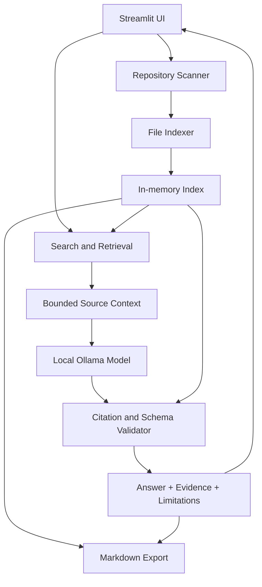

# RepoPilot — Solution Specification

## 1. Executive summary

RepoPilot is a local-first AI codebase investigation tool for developers who need to understand unfamiliar repositories. It combines safe repository scanning, lightweight code indexing, evidence-based retrieval, local language-model explanations, and citation validation.

Its core promise is: **understand a codebase faster, with answers you can inspect.**

The MVP is intentionally read-only. It does not modify project files or execute repository code.

## 2. Problem statement

Developers often inherit repositories with incomplete documentation, unfamiliar conventions, or unclear module boundaries. They must manually locate entry points, search symbols, follow imports, and inspect many files before they can confidently make a change.

General-purpose AI assistants may provide plausible but unsupported answers, and hosted tools may be unsuitable for proprietary code or privacy-sensitive projects.

## 3. Proposed solution

RepoPilot indexes eligible source files locally, retrieves the most relevant excerpts for a developer's question, and asks a compatible local open-weight model to explain those excerpts. It validates every displayed citation against the indexed source and exposes the evidence beside the answer.

### Value proposition

- Reduce manual exploration of unfamiliar code.
- Keep repository contents local when the full configured workflow is local.
- Make answers inspectable through file and line citations.
- Provide useful search and browsing even without an AI model.
- Generate repeatable repository and investigation reports.

## 4. Target users and use cases

### Primary users
- Freelancers taking over existing client code.
- Small software agencies onboarding developers.
- Developers contributing to open-source projects.
- Maintainers documenting code and investigating bugs.

### MVP use cases
1. “Where is authentication implemented?”
2. “Which files call this function?”
3. “What happens when this input is invalid?”
4. “Where should I begin to understand this feature?”
5. “Create an overview of the repository structure.”

The MVP should not promise complete call-graph analysis, exhaustive vulnerability detection, or autonomous bug fixing.

## 5. Functional requirements

### FR-1: Repository selection
- Accept a local directory path.
- Validate that it exists and can be read.
- Display useful errors for invalid paths.

### FR-2: Safe scanning
- Traverse supported source and documentation files.
- Exclude sensitive files, generated files, dependencies, binaries and oversized files.
- Avoid following symlinks outside the repository.
- Report scan counts and exclusions.

### FR-3: Indexing
- Store repository-relative path, language, text and line metadata.
- Provide a lightweight in-memory index for the MVP.
- Avoid executing or importing repository code.

### FR-4: Search
- Search code using exact identifiers and keyword matching.
- Rank relevant results.
- Display source excerpts with valid line numbers.

### FR-5: AI Q&A
- Use a local Ollama endpoint by default.
- Retrieve relevant excerpts before constructing the prompt.
- Return a structured explanation, citations and limitations.
- Handle missing model, timeout and malformed response states.

### FR-6: Citation validation
- Validate file path and line range against indexed content.
- Reject citations that do not resolve to real source.
- Display source excerpts beside answers.

### FR-7: Export
- Generate Markdown repository summaries and investigation reports.
- Include the question, answer, validated citations and limitations.
- Keep exports user-initiated.

## 6. Non-functional requirements

- **Privacy:** no external LLM API required for the default MVP workflow.
- **Safety:** repository content is read-only and treated as untrusted input.
- **Reliability:** search works if the model is unavailable.
- **Transparency:** unsupported claims and skipped files are disclosed.
- **Maintainability:** modules have clear boundaries and unit tests.
- **Portability:** support Windows, Linux and macOS where dependencies permit.
- **Accessibility:** keyboard focus, readable contrast, and labels for controls.

## 7. Architecture

### Data flow
1. The user chooses a repository root.
2. The scanner resolves and validates paths.
3. Eligible files are indexed with line metadata.
4. Search retrieves relevant excerpts.
5. The local model receives the question and bounded excerpts.
6. The validator checks response schema and source references.
7. The UI displays the answer and evidence.
8. The user may export a report.

## 8. Data model

### Indexed file
- `relative_path`: repository-relative path.
- `language`: detected language or file type.
- `line_count`: total number of lines.
- `content`: eligible source text in memory.
- `indexed_at`: timestamp for the current session, if needed.

### Search result
- `relative_path`
- `start_line`
- `end_line`
- `excerpt`
- `score` or ranking signal

### Investigation response
- `answer`
- `citations[]`
- `limitations[]`
- `confidence`: `high`, `medium`, or `low`

The confidence value is advisory model output, not a calibrated probability. Citation validation must be performed independently by application code.

## 9. Product and business model

### Free local tier
- Repository browsing and search.
- Local AI explanations.
- Evidence citations.
- Basic Markdown exports.

### Potential paid tier, subject to validation
- Agency-branded onboarding reports.
- Reusable documentation templates.
- Advanced dependency and impact maps.
- Team workflows and integrations.
- Larger-repository indexing improvements.

Do not build billing before testing whether users will pay for the workflow. The strongest initial validation is a small number of developers using RepoPilot on real, authorized repositories and reporting whether it saves time.

## 10. MVP scope and exclusions

### Included
- Local repository scanner.
- Keyword search and line-numbered excerpts.
- Local AI integration.
- Citation validation.
- Streamlit UI.
- Markdown export.
- Automated tests and documentation.

### Excluded from initial release
- Autonomous code modifications.
- Shell command execution by the model.
- Hosted accounts or billing.
- Mandatory cloud APIs.
- IDE plugins.
- Guaranteed vulnerability detection.
- Full semantic indexing of very large repositories.

## 11. Risks and mitigations

| Risk | Mitigation |
|---|---|
| AI hallucination | Retrieval-grounded prompts and citation validation |
| Prompt injection in repository text | Treat repository content as untrusted evidence, not instructions |
| Secret exposure | Exclusion rules, bounded scanning, no raw source logging |
| Slow indexing | File-size/count limits; measure before optimizing |
| Model unavailable | Search remains functional and setup guidance is shown |
| Weak small-model reasoning | Evaluate on known questions and disclose limitations |
| Incorrect line references | Validate ranges against indexed source and show original excerpt |
| Misleading privacy claim | Document all network behavior and avoid unsupported “fully offline” claims |

## 12. Evaluation plan

Prepare a small test repository with known answers. Create a fixed set of questions and expected supporting files.

Track:
- Whether the correct file appears in retrieved results.
- Whether citation paths and line ranges are valid.
- Whether answers are supported by the cited excerpts.
- How often the system correctly admits insufficient evidence.
- End-to-end latency on the target machine.
- Whether the user can complete the main flow without instructions.

Report measured results only; do not invent accuracy or productivity statistics.

## 13. Release acceptance criteria

- The documented app command starts successfully.
- A user can scan a sample repository.
- Search returns relevant excerpts and accurate line numbers.
- Local AI answers a supported question using retrieved context.
- Invalid citations are rejected.
- Model failure does not disable search.
- Tests pass and README instructions work on a clean environment.
- Demo contains no proprietary code or secrets.
- Model and project licenses are documented.

## 14. Roadmap

### MVP
Scanner, search, local AI Q&A, evidence validation, export, tests and documentation.

### Next
Symbol-aware parsing, import/reference navigation, improved retrieval, persistent local index and richer repository summaries.

### Later
IDE integration, team knowledge workflows, agency reporting, repository comparisons and paid features after user validation.
