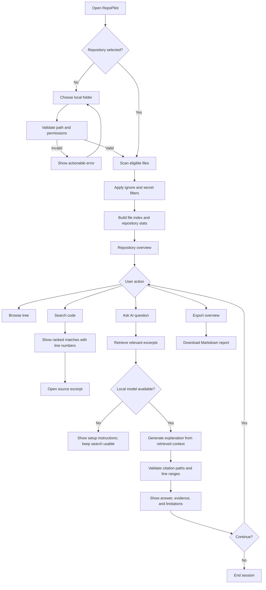

# RepoPilot — User Flow

## 1. Product goal

RepoPilot helps developers understand unfamiliar codebases with a local-first AI assistant. It indexes repository files, retrieves relevant code, explains how the code works, and provides verifiable file-and-line citations.

**Primary user journey:** Select repository → scan and index → ask a question → inspect evidence → export or continue investigating.

## 2. Primary personas

- **Freelancer / consultant:** inherits an unfamiliar client project and needs to understand it quickly.
- **Agency developer:** onboards to a repository and traces features or bugs across files.
- **Open-source contributor:** discovers where a feature is implemented before proposing a change.
- **Maintainer:** creates an overview or onboarding report for a project.

## 3. Main flow

## 4. First-run flow

1. User opens RepoPilot.
2. App explains that repository scanning is read-only and describes which file types are indexed.
3. User enters or selects a local repository directory.
4. App validates that the directory exists and can be read.
5. App scans eligible files while excluding secrets, generated files, dependency folders, binaries, oversized files, and symlinks.
6. App displays scan status, file count, detected languages, and skipped-file summary.
7. User can browse or search without configuring AI.
8. If AI is requested and Ollama is unavailable, the app provides setup guidance without breaking search.

## 5. Question-and-answer flow

1. User enters a repository-specific question, e.g. “Where is authentication checked?”
2. RepoPilot searches indexed source and ranks candidate excerpts.
3. The retrieval layer selects a bounded set of excerpts with relative paths and line numbers.
4. The local model receives the question and retrieved evidence, not the whole repository.
5. The model returns an explanation and references to evidence.
6. The citation validator checks that referenced paths are indexed, stay inside the repository, and contain the claimed line ranges.
7. The UI presents:
   - Answer
   - Evidence list with path and line range
   - Expandable source excerpts
   - Limitations or missing context
8. User can open a citation, refine the question, or export the result.

## 6. Core screens

### A. Welcome / repository selection
- RepoPilot branding and one-sentence value proposition.
- Local repository path input and browse action where supported.
- Privacy note: local-first operation; model requests go to the configured local endpoint.
- Clear scan and model status.

### B. Repository overview
- Repository path and scan status.
- File count, language breakdown, skipped files.
- Navigable file tree.
- Actions for Search, Ask RepoPilot, and Export.

### C. Code search
- Search query input.
- Ranked results with file path, match count, and line range.
- Source excerpt with line numbers.
- Empty state with suggestions.

### D. AI investigation
- Question input and submit action.
- Answer panel.
- Evidence citations and source viewer.
- “Insufficient evidence” state when retrieval is weak.
- Model unavailable / timeout error state.

### E. Export
- Markdown repository overview.
- Markdown investigation report containing question, answer, validated citations, and limitations.
- No automatic upload or external sharing.

## 7. Edge cases and recovery

| Scenario | Expected behavior |
|---|---|
| Invalid or inaccessible path | Explain the problem and let user retry |
| Empty repository | Show empty state and suggest adding supported source files |
| No search matches | Say no matches were found; offer alternate terms |
| No local model installed | Keep repository browsing/search available and show setup steps |
| Ollama is stopped | Display connection error and retry guidance |
| Model returns invalid citations | Reject invalid references; show only validated evidence |
| Question is unsupported | State what information is missing |
| File is too large or binary | Skip safely and include a reason in scan summary |
| Symlink escapes repository | Do not follow it |
| Repository contains prompt injection | Treat repository content as untrusted data, never as instructions |
| User changes repository | Clear stale index and rebuild it |
| Export fails | Show error and preserve current session |

## 8. MVP success criteria

- A new user can select and scan a sample repository.
- Keyword search returns correct file paths and line numbers.
- A question about a known function returns an answer grounded in retrieved excerpts.
- Every displayed citation passes validation.
- Search remains usable when the model is unavailable.
- No repository code is executed by RepoPilot.
- User can export a Markdown report.
